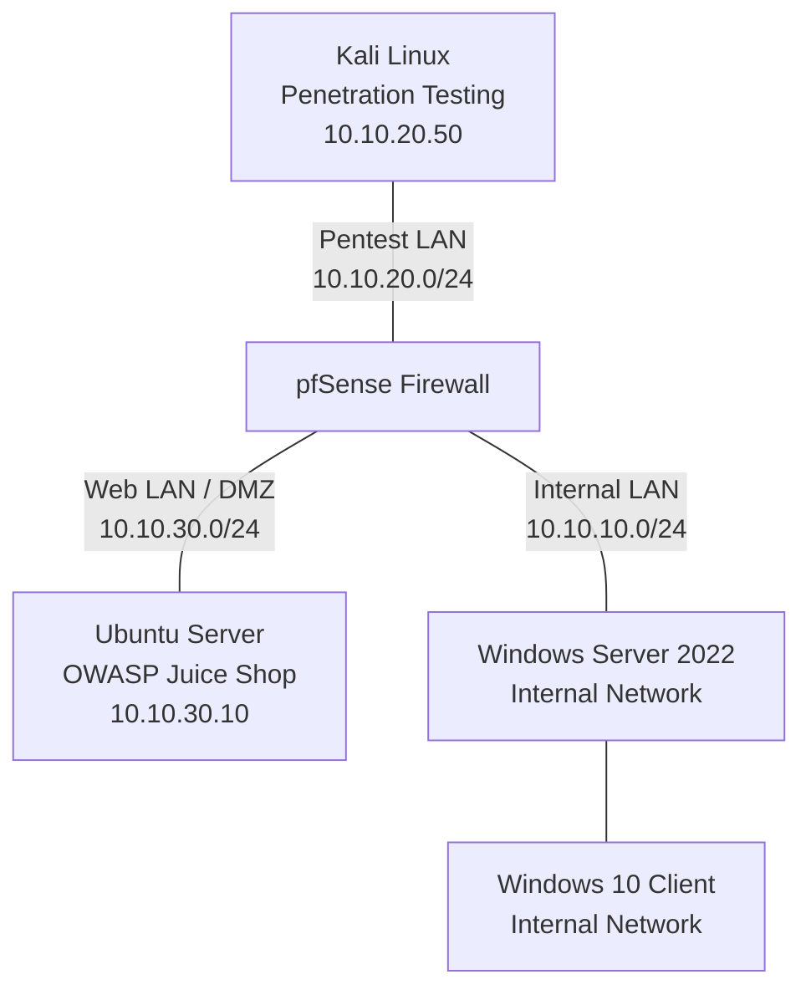

# Technical Documentation

This directory contains detailed documentation covering the lab architecture, environment setup, penetration testing methodology, findings, and remediation recommendations.

## Network Architecture

The lab uses pfSense to connect and control traffic between three network segments.

**Important:** This diagram represents the intended logical architecture. Firewall enforcement, domain configuration, and connectivity must be independently validated before treating the diagram as proof of those controls.

## Network Design Rationale

The lab separates the penetration-testing environment, web-facing systems, and internal enterprise systems into distinct network segments.

### Network Segments

| Segment | Subnet | Purpose |
|---|---|---|
| Internal LAN | 10.10.10.0/24 | Windows Server and Windows client environment |
| Pentest LAN | 10.10.20.0/24 | Kali Linux security testing environment |
| Web LAN / DMZ | 10.10.30.0/24 | Intended location for the Ubuntu web server and OWASP Juice Shop |

### Firewall Role

pfSense serves as the central firewall for the lab. Its role is to control traffic between the network segments and provide a foundation for testing network isolation and access restrictions.

### Security Testing Objectives

- Verify connectivity between the intended systems.
- Determine which services are reachable from each segment.
- Evaluate whether firewall rules enforce the intended network boundaries.
- Assess whether a compromised web-facing system could reach internal services.
- Document findings and recommend mitigations.

Firewall behavior and access restrictions will be recorded only after they have been tested and verified.

