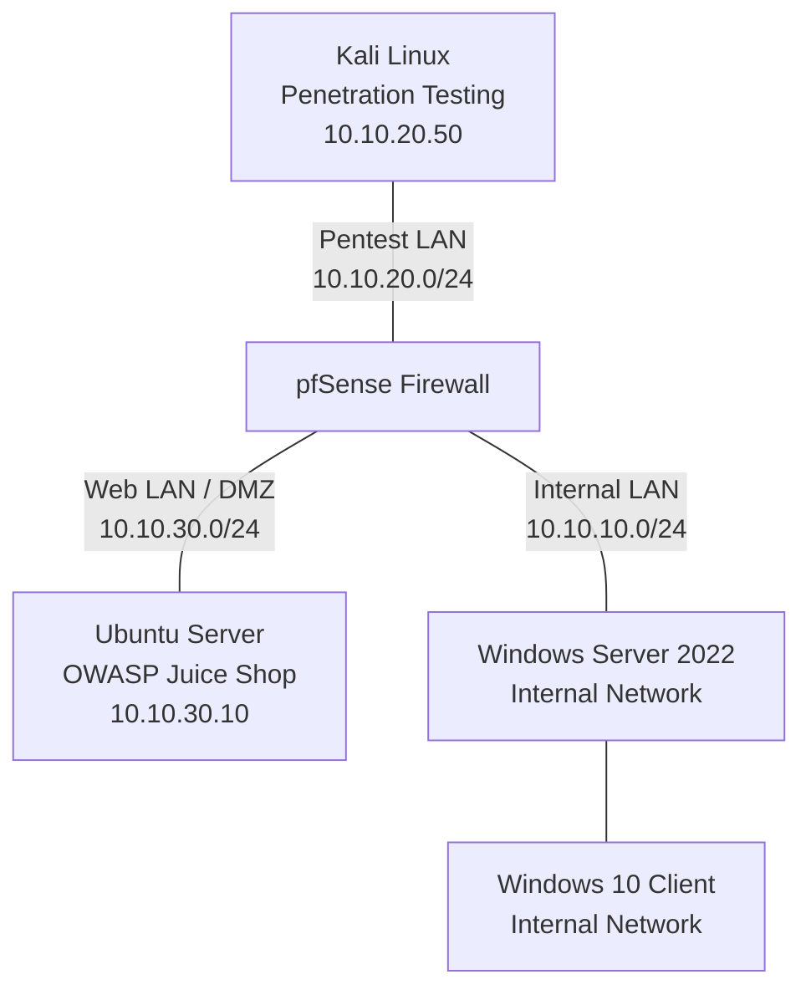

# Technical Documentation

This directory contains detailed documentation covering the lab architecture, environment setup, penetration testing methodology, findings, and remediation recommendations.

## Network Architecture

The lab uses pfSense to connect and control traffic between three network segments.

**Important:** This diagram represents the intended logical architecture. Firewall enforcement, domain configuration, and connectivity must be independently validated before treating the diagram as proof of those controls.
